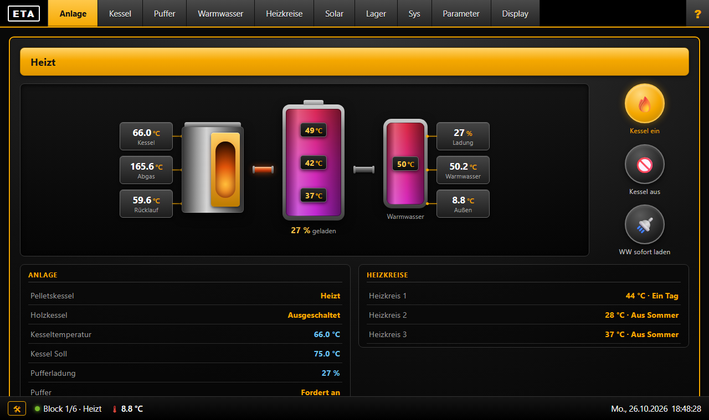
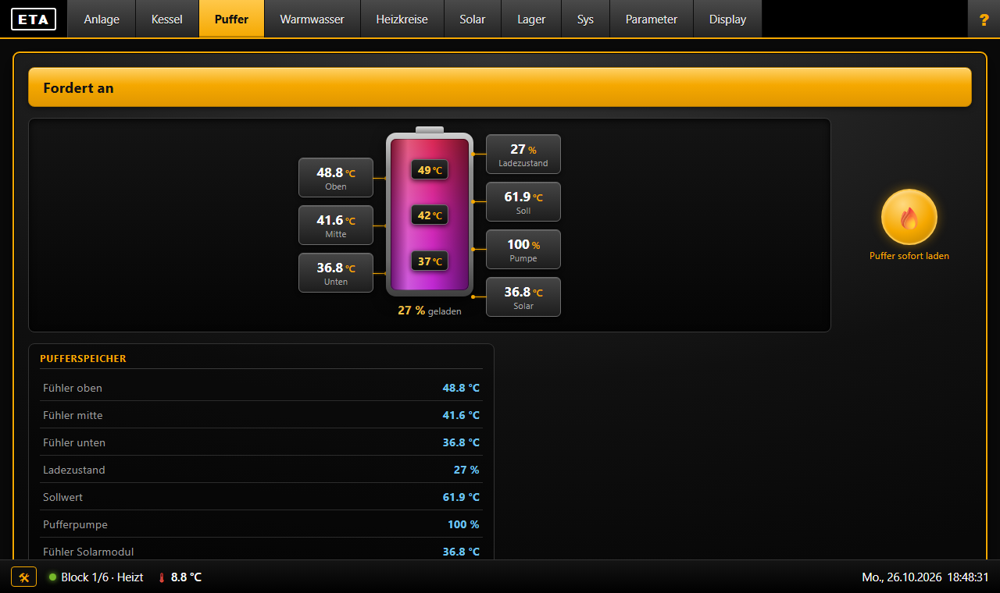
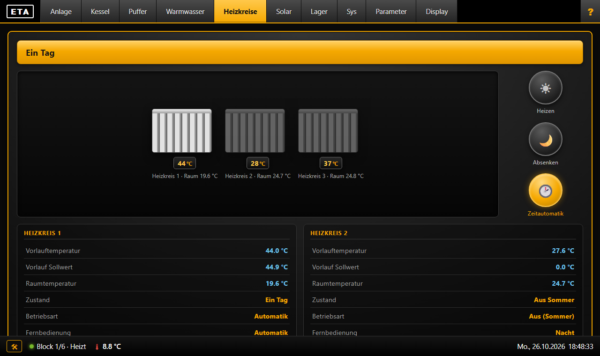
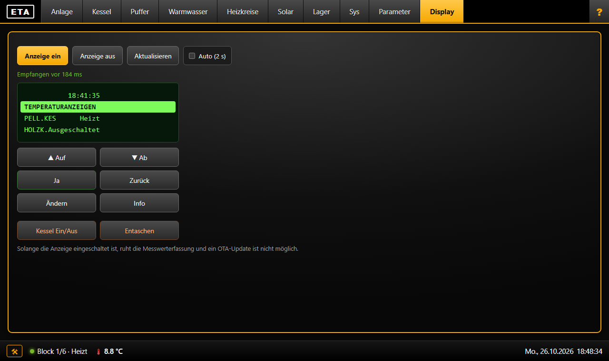
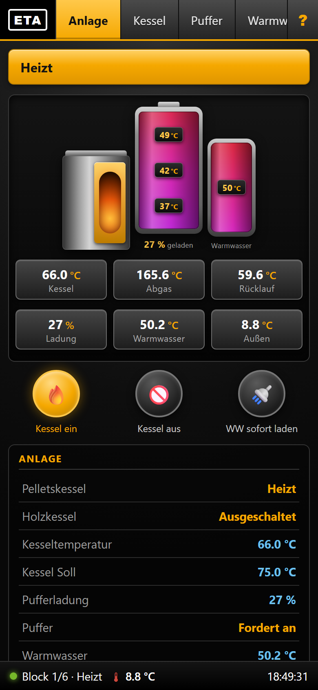
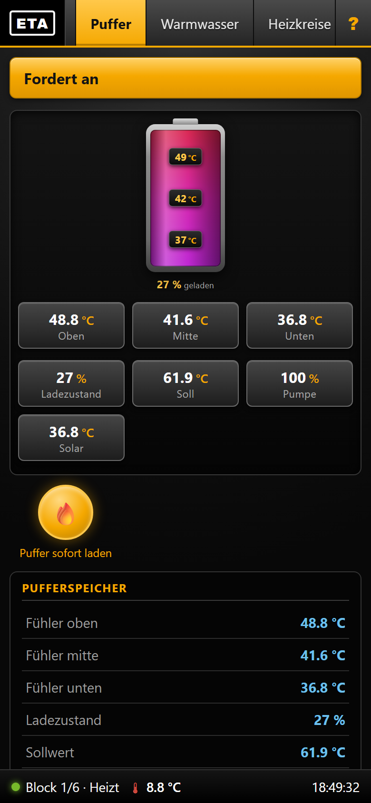
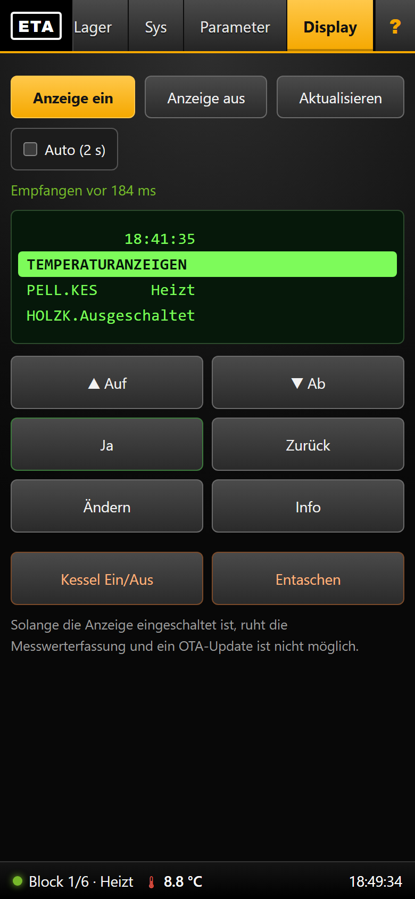

# ETA Twin Monitor – ESP32 (eByte ECM50-A06 / ESP32-S3)

Liest die Messwerte eines ETA-Pelletkessels über die RS232-Schnittstelle aus
und stellt sie als Web-Dashboard (Handy und PC) und JSON-API bereit.
Einzelne Einstellwerte (z. B. die Einschaltverzögerung) lassen sich begrenzt schreiben.
Getestet mit einem **ETA Twin** (Stückholzkessel mit Pelletbrenner) und dem **EBYTE ECM50-A06**.

106 Messwerte · Gerät im Netz: `http://<IP-des-Monitors>/` bzw. `http://eta-monitor.local/`

Aktuelle Version und Änderungen: [CHANGELOG.md](CHANGELOG.md)

> **Inoffizielles Hobbyprojekt.** Es steht in keiner Verbindung zu ETA Heiztechnik GmbH;
> „ETA“ ist eine Marke des Herstellers und wird hier nur zur Beschreibung der
> Kompatibilität genannt. Das Protokoll ist aus öffentlichen Quellen und eigenen
> Messungen abgeleitet (siehe Abschnitt 7). Die Nutzung erfolgt **auf eigene Gefahr** –
> insbesondere das Schreiben von Parametern greift in die Regelung deiner Heizung ein.
> Es gibt keine Gewährleistung.

---

## Screenshots

Das Dashboard läuft direkt auf dem ESP32 und passt sich Handy und PC an.
(Die Aufnahmen zeigen Live-Werte einer ETA-Twin-Anlage.)

**PC**



| Puffer | Heizkreise |
|---|---|
|  |  |

**Kesseldisplay mit Fernbedienung** (gewählte Zeile wird hervorgehoben)



**Handy**

<p>



</p>

---

## Projektstruktur

```
ETA_Monitor/
├── ETA_Monitor.ino      ← Hauptprogramm (ESP32-S3 / Arduino)
├── dashboard_html.h     ← Web-Dashboard (HTML/CSS/JS, PROGMEM)
├── config.example.h     ← Konfigurations-Vorlage (im Repo)
├── config.h             ← Eigene Einstellungen (lokal, NICHT im Repo!)
└── platformio.ini       ← PlatformIO Board-/Build-Konfiguration
tools/
├── collect_scan.ps1     ← Monitorliste des Kessels mehrfach abfragen
├── merge_scan.py        ← Scan-Ergebnisse zusammenführen und tabellieren
├── export_eta_data.py   ← Messwerte als JSON/XML exportieren
└── eta_config.example.ini
docs/screenshots/        ← Bilder für dieses README
CHANGELOG.md             ← Versionshistorie
```

## 1. Hardware

### Benötigte Teile

| Teil | Beschreibung |
|---|---|
| **EBYTE ECM50-A06** | Industrieller Steuerungscomputer mit ESP32-S3 (laut Händlerangabe u. a. RS232, RS485, Modbus RTU, Ethernet, LoRa, 2 DI / 2 AI / 2 DO). 

Auf anderer ESP32-S3-Hardware mit RS232-Pegelwandler läuft die Firmware ebenfalls,
dazu `ETA_RX_PIN`/`ETA_TX_PIN` in `config.h` anpassen. In `platformio.ini` ist das Board
`esp32-s3-devkitc-1` eingestellt.

> **Wichtig:** Der ETA-Kessel liefert ±12 V RS232-Pegel, der ESP32 arbeitet mit
> 3,3 V TTL. Ohne Pegelwandler wird der ESP32 **dauerhaft beschädigt** – das
> ECM50-A06 hat den Wandler bereits an Bord.

### Verdrahtung

```
ETA-Kessel Sub-D 9-pol              ECM50-A06
---------------------------------------------
Pin 2  (TX des Kessels)  --->  RX   GPIO18
Pin 3  (RX des Kessels)  <---  TX   GPIO17
Pin 5  (GND)             -----  GND
```

Serielle Parameter: **19200 Baud, 8N1** (UART2).

---

## 2. Knoten (Nodes) – der wichtigste Punkt

Ein ETA-Kessel besteht aus mehreren Modulen mit jeweils eigener
**Knotennummer**. Welche Knoten vorhanden sind und welcher Index welchen Wert
liefert, ist **anlagenspezifisch** – Listen aus dem Internet passen in der
Regel *nicht*.

Bei dieser Anlage (ETA Twin):

| Knoten | Rolle | Beispielwerte |
|---|---|---|
| **8** | Kesselregelung / Hydraulik | Kessel, Kesselrücklauf, Puffer oben/mitte/unten, Boiler, Pufferladung |
| **16** | Pelletsteil „PELL.KES“ | Verbrennung, Gebläse, Luftschieber, Restsauerstoff, Zählerstände |
| **33** | Heizkreis-/Solarmodul | MK1–MK3 Vorlauf/Raum, Kollektor, Außentemperatur, Thermostat |

### Eigene Knoten/Indizes ermitteln

Die Firmware kann die **Monitorliste direkt aus dem Kessel auslesen**:

```powershell
Invoke-WebRequest "http://<IP-des-Monitors>/scan?start=1&level=1" -Method POST
Start-Sleep 30
Invoke-WebRequest "http://<IP-des-Monitors>/scan" -UseBasicParsing | % Content > _scan.json
```

Komfortabler über die Hilfsskripte:

```powershell
.\tools\collect_scan.ps1 -Ip eta-monitor.local   # mehrere Level/Durchläufe sammeln
python tools\merge_scan.py                       # zusammenführen und als Tabelle ausgeben
```

Jede Zeile enthält Knoten (`k`), Index (`ie`), Datentyp (`dt`), Teiler (`t`)
und Klartextnamen (`n`) – daraus werden die Einträge in `s_params[]` in
`ETA_Monitor.ino` gebildet.

---

## 3. Konfiguration (config.h)

```cpp
// WLAN
#define WIFI_SSID     "MeinHeimnetz"
#define WIFI_PASS     "MeinPasswort"

// RS232-Pins
#define ETA_RX_PIN    18
#define ETA_TX_PIN    17
#define ETA_BAUD      19200

// Knoten der Anlage (siehe Abschnitt 2)
#define ETA_NODE_KESSEL   8
#define ETA_NODE_PELLET   16
#define ETA_NODE_HK       33

// Abfrage-Intervall und Blockwechsel
#define ETA_INTERVAL_SEC  60
#define ETA_BLOCK_SEC     5
```

Falls kein WLAN erreichbar ist, spannt der ESP32 automatisch einen
**Access Point** auf:
- SSID: `ETA-Monitor`
- Passwort: `AP_PASS` aus `config.h`
- URL: `http://192.168.4.1/`

---

## 4. Bauen & Hochladen (PlatformIO)

Das OTA-Passwort steht **nicht** in `platformio.ini`, sondern wird aus der
Umgebungsvariable `ETA_OTA_PASS` gelesen (Wert = `OTA_PASS` aus `config.h`):

```powershell
cd ETA_Monitor
$env:ETA_OTA_PASS = "<OTA_PASS aus config.h>"

# Kompilieren
& "$env:USERPROFILE\.platformio\penv\Scripts\pio.exe" run

# Per WLAN hochladen (funktionierende Methode)
& "$env:USERPROFILE\.platformio\penv\Scripts\pio.exe" run -t upload --upload-port <IP-des-Monitors>
```

Der Upload meldet am Ende `Result: OK / Success`. Der Exit-Code 1 von
`espota.py` ist ein bekannter Kosmetikfehler und kann ignoriert werden.

> Der Web-Upload über `http://<IP>/update` ist unzuverlässig (Timeouts) –
> bitte den espota-Weg oben verwenden.

Web-Benutzer: `admin`, Passwort: `OTA_PASS`.
Erstinbetriebnahme per USB, danach nur noch über WLAN.

> **Sicherheit:** Dashboard und API laufen unverschlüsselt über HTTP. Gerät nur im
> vertrauenswürdigen Heimnetz betreiben, **nie** per Portfreigabe ins Internet stellen
> und ein langes, eigenes `OTA_PASS` setzen – wer es kennt, kann den Kessel bedienen.

---

## 5. Endpunkte

| URL | Methode | Beschreibung |
|---|---|---|
| `/` | GET | Web-Dashboard mit 10 Reitern (**Anmeldung nötig**, damit der Browser die Zugangsdaten für die Bedienelemente mitsendet) |
| `/api` | GET | JSON mit allen Messwerten (siehe Abschnitt 6) |
| `/scan` | GET/POST | Monitorliste des Kessels auslesen (`?start=1&level=1..4`) |
| `/params` | GET/POST | Parameterliste auslesen (`?start=1&level=1..4`) – Einstellungen mit Min/Max/Standard/Istwert |
| `/texts` | GET/POST | Textliste auslesen (`?start=1`) – Klartexte für alle Aufzählungswerte |
| `/interval` | POST | Abfrageintervall setzen (**Anmeldung + Header `X-ETA`**) |
| `/display` | GET | Aktuelle Anzeige als JSON (`lines`, `text`, `status`, `raw`, `age_ms`) |
| `/display?on=1` \| `?on=0` | GET/POST | Spiegelung der Kesselanzeige ein-/ausschalten (ohne Anmeldung, harmlos) |
| `/display?key=<taste>` | POST | Tastendruck senden (`aendern`, `ja`, `auf`, `ab`, `zurueck`, `info`, `kessel`, `entaschen` oder `0`–`7`) – **Anmeldung + Header `X-ETA`** |
| `/cmd` | POST | Steuerbefehl: `?cmd=reset` \| `auto` \| `tag` \| `nacht` \| `kessel_ein` \| `kessel_aus` \| `boiler` – **Anmeldung + Header `X-ETA`** |
| `/set` | GET | Freigabeliste der schreibbaren Einstellwerte, Limits und Zähler (nur lesend) |
| `/set?name=<Parameter>&val=<Zahl>` | POST | Einstellwert im Kessel setzen (`{MJ}`), siehe Abschnitt „Schreiben von Einstellwerten“ – **Anmeldung + Header `X-ETA`** |
| `/update` | GET/POST | Web-OTA (unzuverlässig, siehe oben) |

**Anmeldung für ändernde Aufrufe:** Benutzer `admin`, Passwort `OTA_PASS` aus
`config.h` (HTTP Basic) und der Header `X-ETA: 1`. Der Header schützt vor
Aufrufen aus fremden Webseiten. Lesende Aufrufe bleiben ohne Anmeldung.

### Schreiben von Einstellwerten (`/set`)

Der Schreibbefehl ist `{MJ len=5 PS Knoten IdxHi IdxLo WertHi WertLo}`
(Symcon-Thread 16637, Beitrag 48), der Kessel bestätigt mit `{MK}`.
Rohwert im Kessel = Anzeigewert × Teiler der Parameterliste `{Mg}`.

Nur Parameter der Freigabeliste `s_writeParams` in `ETA_Monitor.ino` sind
schreibbar (aktuell `Einschaltverz`, Menü PELL.KES → Zustandstimer, 0–240).
Der Wert ist in **Zehntelstunden** anzugeben (`val=10` = 1,0 h, `val=20` = 2,0 h);
im Kessel steht der Rohwert Zehntelstunden × 60 (am Display verifiziert).
Weil der Parameterspeicher des Kessels vermutlich begrenzte Schreibzyklen hat
(Herstellerangabe unbekannt), gelten Mindestabstand 10 min je Parameter und
höchstens 6 Schreibvorgänge je 24 h; ein bereits bestätigter Wert wird nicht
erneut geschrieben. **Niemals zyklisch schreiben** (ETAmon kennt dafür die
Funktion „Schreibzyklus in sec“ – hier bewusst nicht vorgesehen).

Vor dem ersten Schreiben den aktuellen Wert über `/params` lesen
(`akt`) und notieren. Nach dem Schreiben den Wert am Kessel-Display prüfen.

```powershell
$h = @{ 'X-ETA' = '1' }
$cred = Get-Credential admin      # Passwort = OTA_PASS
Invoke-RestMethod -Method Post -Uri 'http://<IP-des-Monitors>/set?name=Einschaltverz&val=1' `
    -Headers $h -Credential $cred -AllowUnencryptedAuthentication
```

### Beispiel `/api` Antwort

```json
{
  "online": true,
  "uptime_s": 3600,
  "last_data_s": 12,
  "fw": "2.2.0",
  "interval": 60,
  "block": 2, "blocks": 6,
  "packets": 411, "timeouts": 0,
  "error": "",
  "nodes": { "8": true, "16": true, "33": true },
  "sensors": {
    "Kessel":        { "value": 72.3,  "unit": "°C", "age_s": 8, "stale": false },
    "Puffer_oben":   { "value": 63.4,  "unit": "°C", "age_s": 8, "stale": false },
    "Pelletsvorrat": { "value": 11.74, "unit": "t",  "age_s": 8, "stale": false }
  }
}
```

Ein Sensor mit `"value": null` bedeutet: Der Kessel meldet für diesen Index
„kein Sensor angeschlossen“ (Rohwert `0x8000`) oder der Wert war unplausibel.

---

## 6. Anbindung an andere Systeme

Die Firmware stellt eine offene REST-Schnittstelle bereit. Es wird **keine
zusätzliche Integration** benötigt – ein einfacher HTTP-GET auf `/api` genügt.
Diese Sektion ist die Referenz für externe Projekte (Home Assistant, ioBroker,
Node-RED, Grafana …).

### Grundlagen

| Punkt | Wert |
|---|---|
| Basis-URL | `http://<IP-des-Monitors>` bzw. `http://eta-monitor.local` |
| Authentifizierung | keine |
| CORS | `Access-Control-Allow-Origin: *` |
| Antwortformat | JSON, UTF-8 |
| Sinnvolles Abrufintervall | 30–60 s |

Ein einzelner Request liefert **alle** Sensoren. Häufigeres Abrufen bringt
nichts, weil der Kessel selbst nur alle `ETA_INTERVAL_SEC` (Standard 60 s)
sendet – das Abrufintervall des Fremdsystems belastet den Kessel nicht.

Im Router ein statisches DHCP-Lease setzen, sonst ändert sich die IP.

### Struktur der Antwort

```json
{
  "online": true,
  "uptime_s": 939,
  "last_data_s": 25,
  "fw": "2.2.0",
  "interval": 60,
  "block": 1,
  "blocks": 6,
  "packets": 120,
  "timeouts": 0,
  "error": null,
  "error_age_s": -1,
  "nodes": { "8": true, "16": true, "33": true },
  "sensors": {
    "Kessel": { "value": 26.00, "unit": "°C", "age_s": 27, "stale": false }
  }
}
```

| Feld | Bedeutung |
|---|---|
| `online` | Es wurden schon Daten vom Kessel empfangen |
| `last_data_s` | Sekunden seit dem letzten Paket – für einen Verbindungs-Sensor |
| `error` | Klartext der letzten Kessel-Störmeldung (`IM`-Paket), sonst `null` |
| `nodes` | Welche Module geantwortet haben (`33` fehlt, wenn kein Solarmodul da ist) |
| `sensors.X.value` | Messwert oder `null`, wenn kein Fühler angeschlossen ist |
| `sensors.X.stale` | Wert älter als 2,5 Zyklen – als Verfügbarkeitsbedingung nutzbar |

**Empfohlene Verfügbarkeitsprüfung** für einen Sensor:

```
online == true  &&  sensors.X.value != null
```

### Verfügbare Sensoren

`value` ist immer eine Zahl, die Skalierung ist bereits angewendet.

**Kessel und Puffer** – Einheit `°C`, außer wo angegeben

| Schlüssel | Bedeutung |
|---|---|
| `Kessel` | Kesseltemperatur |
| `Kessel_Ruecklauf` | Kesselrücklauf |
| `Kessel_Pellet` | Kessel IST (Pelletteil) |
| `Kessel_Soll` | Kessel Soll |
| `Abgas`, `Abgas_Kessel` | Abgastemperatur |
| `Abgas_Soll` | Abgas Sollwert |
| `Boiler` | Boiler |
| `Puffer_oben`, `Puffer_mitte`, `Puffer_unten` | Pufferfühler |
| `Pufferladung` | Ladezustand, `%` |
| `Boardtemp`, `Boardtemp_Kessel` | Platinentemperatur |
| `Boardtemp_max`, `Boardtemp_max_K` | Maximalwert der Platine |

**Sollwerte und Pumpen** (ab FW 2.2.0)

| Schlüssel | Bedeutung / Einheit |
|---|---|
| `Kessel_Soll`, `Puffer_Soll`, `Boiler_Soll` | Sollwerte `°C` |
| `Ruecklauf_Soll`, `Abgas_Soll_K` | Sollwerte Kesselregelung `°C` |
| `Pufferpumpe`, `Boilerpumpe`, `Kollektorpumpe` | Ansteuerung `%` |
| `Pumpe_MK1`–`Pumpe_MK3` | Heizkreispumpen `%` |
| `Leistung_Soll`, `Leistung_Soll_K` | Kesselleistung `%` |
| `O2_Ist`, `O2_Soll` | Restsauerstoff `%` – nur im Brennbetrieb aktuell |
| `Vorlauf_Soll_MK1`–`MK3` | Vorlauf-Sollwert `°C` |
| `Freigabe_MK1`–`MK3` | Freigabetemperatur des Heizkreises `°C` |
| `Solarleistung` | Rohwert des Solarmoduls |

Aufzählungswerte dieser Gruppe (`Boiler_Status`, `Puffer_Status`,
`Betrieb_MK*`, `Party_MK*`, `Mischer_MK*`, `Kollektor_Status`,
`Solar_Ladung_auf`, `Solarvorrang`, `Thermostat`, `Stoerungsmeldung`,
`Holzkessel`, `Anfahrentlastung`, `Kesseltuer`, `Wassermangel`, `STB`,
`Kesseltemp_Waechter`, `Sicherung_24VAC`) sind unten unter
[Aufzählungswerte](#aufzählungswerte) beschrieben.

**Brenner**

| Schlüssel | Einheit |
|---|---|
| `Geblaesedrehzahl` | `U/min` |
| `Geblaese_Soll` | `%` |
| `Luftschieber`, `Luftschieber_Soll` | `%` |
| `Restsauerstoff` | `%` – nur im Brennbetrieb gültig, sonst `null` |

**Zähler** – laufen über 32767 hinaus, daher unsigned zu lesen

| Schlüssel | Einheit |
|---|---|
| `Betriebsstunden`, `Abgasgeblaese_Lz`, `Wartung_Kessel` | `h` |
| `Board_ueber_40` … `Board_ueber_70` | `h` |
| `Gesamtverbrauch`, `Pelletsvorrat`, `Wartung_Verbrauch` | `t` |
| `Behaelterinhalt`, `kg_seit_Entasch`, `Verbr_seit_Entasch` | `kg` |
| `Uebertemp_Zaehler`, `RL_tief_Warnung` | dimensionslos |

**Heizkreise und Solar** – Einheit `°C`

`Aussen` · `Vorlauf_MK1` … `Vorlauf_MK3` · `Raum_MK1` … `Raum_MK3` ·
`Kollektor` · `Puffer_Solar` · `Boiler_oben_Solar` · `Boiler_unten_Solar` ·
`Thermostat_heiss` · `Thermostat_kalt`

Die Solarwerte fehlen, wenn Knoten 33 nicht antwortet.


### Aufzählungswerte

Diese Sensoren liefern Zahlen ohne Einheit und sollten im Zielsystem gemappt
werden:

| Schlüssel | Werte |
|---|---|
| `Betriebszustand` | 0 Ausgeschaltet · 1 Heizversuch · 2 Zündet · 3 Heizt · 4 Glutabbrand · 5 Bereit · 6/7 Entaschen · 8 Störung · 32 Gesperrt · 33 Fremdwärme · 79 Warten (Einschaltverzögerung läuft, am Display „PELL.KES Warten“; verifiziert 25.10.2026) |
| `Holzkessel` | 0 Tür offen · 1 Heizt an · 2 In Betrieb · 3 Übertemperatur · 4 Glutabbrand · 5 Feuer aus · 6 Ausgeschaltet · 7 Störung |
| `Boiler_Status` | 0 Laden · 1 Geladen · 2 Fordert an · 3 Nachlauf · 4 Störung |
| `Puffer_Status` | 0 Geladen · 1 Fordert an · 2 Störung · 3 ÜberTmp. laden |
| `MK1`, `MK2`, `MK3` | 0 Ein Tag · 1 Ein Nacht · 2/3 Ein Fern Tag/Nacht · 4–9 Aus (Soll/Außen) · 10 Aus Sommer · 11 Aus Kessel zu kalt · 12 Aus Puffer zu kalt · 13 WW-Vorrang · 14 Frostschutz · 15 Ein Übertemperatur · 16 Störung |
| `Betrieb_MK1`–`Betrieb_MK3` | 0 Automatik · 1 Aus (Sommer) · 2 Urlaub · 3 Tag · 4 Nacht |
| `Party_MK1`–`Party_MK3` | 0 Automatik · 1 Tag · 2 Nacht |
| `Kollektor_Status` | 0 Aus · 1 Ein · 2 Aus Speicher> · 3 Störung · 4 Aus Brennertemp.< · 5 Aus Kollektor> |
| `Solar_Ladung_auf` | 0 Puffer · 1 Boiler · 2 Nachladen · 3 Absenkung |
| `Solarvorrang` | 0 Deaktiviert · 1 Außen< · 2 Kein · 3 Mittel · 4 Hoch |
| `Lambdasonde` | 0 OK · 1 Heizt auf · 2 Zu kalt · 3 Kurzschluss · 4 Wird gesucht · 5 Unterbrochen · 6 Ausgeschaltet |
| `Raumaustragung` | 0 Aus · 1 Fördert · 2 Nachlauf · 3 Störung · 4 Vorlauf · 5 Standby |
| `Austragschnecke` | 0 Retour · 1 Halt · 2 Vor |
| `Rostklappe`, `Ruecklaufmischer`, `Mischer_MK1`–`MK3` | 0 Zu · 1 Halt · 2 Auf |
| `Wassermangel`, `STB`, `Kesseltemp_Waechter`, `RL_tief_Warnung` | 0 Störung · 1 OK |
| `Kesseltuer` | 0 Offen · 1 Zu |
| `Sicherung_24VAC` | 0 Defekt · 1 OK |
| `Anfahrentlastung` | 0 Unten · 1 Oben |
| `Entaschung`, `Stoerungsmeldung`, `Thermostat` | 0 Aus · 1 Ein |
| `Saugen`, `Boiler_Extraladung` | 0 Nein · 1 Ja |

> **Woher die Texte stammen:** Der Kessel liefert über `{MH}`/`{Mi}` eine
> Textliste je Knoten. Der Klartext eines Aufzählungswerts ergibt sich als
> `Text[ dt + Wert ]`, wobei `dt` der Datentyp aus der Monitorliste (`{Mb}`)
> ist. **Achtung:** Das gilt *nicht* für Prozentwerte – Pumpen haben `dt=37`
> und würden fälschlich auf „LINKS“/„Laden“ abgebildet.

> `Puffer_Status` liefert an dieser Anlage 116, also außerhalb des gültigen
> Bereichs. Der Ladezustand wird deshalb über `Pufferladung` (%) dargestellt.

### Beispiel

```bash
curl http://<IP-des-Monitors>/api
```

```powershell
$a = (Invoke-WebRequest "http://<IP-des-Monitors>/api" -UseBasicParsing).Content | ConvertFrom-Json
$a.sensors.Kessel.value
```

---

## 7. ETA RS232-Protokoll (Zusammenfassung)

Quelle: [Symcon-Community](https://community.symcon.de/t/temperaturwerte-aus-einem-pelletkessel-der-fa-eta-auslesen/16637)

Alle Pakete sind mit `{` und `}` eingeklammert, 19200 Baud 8N1.
Die Prüfsumme ist die Byte-Summe **modulo 256**.

| Befehl | Bedeutung |
|---|---|
| `{MC …}` | Monitor Configure – legt fest, welche Indizes der Kessel zyklisch sendet |
| `{MD …}` | Monitor Data – Antwort des Kessels mit den Messwerten |
| `{MA …}` | Monitorliste (Menübaum) anfordern → Antwort `{Mb}` |
| `{MF …}` | Parameterliste (Einstellungen) anfordern → Antwort `{Mg}` |
| `{MH …}` | Textliste anfordern → Antwort `{Mi}` |
| `{MO 1 1}` | laufende Listenabfrage beenden |

### Rahmenformat aller Pakete

```
'{' | Kennung(2) | len(1) | PS(1) | Nutzdaten(len) | '}'      Gesamtlänge = len + 6
PS = (Summe der Nutzdatenbytes) mod 256
```

> **Wichtig:** Es darf **nicht** auf `}` als Endezeichen getriggert werden.
> Die Nutzdaten von `{Mg}` enthalten regelmäßig das Byte `0x7D` (= `}`).
> Die Firmware liest deshalb längenbasiert: `benötigt = 4 + len`.

### Listenabfragen `{MA}` / `{MF}` / `{MH}`

```
{MA len=2 PS <pos> <level>}   Monitorliste
{MF len=2 PS <pos> <level>}   Parameterliste
{MH len=1 PS <pos>}           Textliste
```

`pos` ist `0x00` beim **Start** der Abfrage und `0x01` zum **Weiterblättern**.
`level` (1–4) wählt die Menüebene: 1 = Endkunde … 4 = Service.
Das Listenende meldet der Kessel mit `len == 0 && PS == 0`.

### Byte-Layout der Antworten (ohne `{` und `}`)

```
{Mb}  [4]=Knoten [5]=HByte [6]=LByte [7]=Überschrift [8]=Datentyp
      [11]=Teiler [12]=Index/Ebene [13..45]=Name (33 Zeichen)

{Mg}  [4]=Knoten [5][6]=Index [7]=Datentyp [8]=Einheit [11]=Teiler
      [12][13]=Min [14][15]=Max [16][17]=Standard [18][19]=Istwert
      [20]=Ebene [21..]=Name (42 Zeichen)

{Mi}  [4]=Knoten [5][6]=Index [7..]=Text (42 Zeichen)
```

Textlisten dieser Anlage: Knoten 0 → 92, Knoten 8 → 162, Knoten 16 → 176,
Knoten 33 → 108 Einträge. Insgesamt liefert `/params` 405 und `/texts` 538
Zeilen.

### Was über `{Mg}` **nicht** erreichbar ist

Die **Wochentagsprogramme** (HEIZZEITEN, LADEZEITEN, PUFFERLADEZEITEN,
ZIRKULATIONSZEITEN, RUHEZEIT) sind keine Parameter und tauchen in der
Parameterliste nicht auf. Sie lassen sich ausschließlich über die
Menünavigation am Display bedienen (Reiter *Display*, Tastenbefehle `{IT}`).

Uhrzeiten in `{Mg}` sind Minuten seit Mitternacht (erkennbar an `max == 1439`),
Datumsangaben (z. B. „Urlaub bis“) sind bitweise gepackt – die Kodierung ist
noch nicht endgültig verifiziert.

### MC-Befehl (Monitor Configure)
```
{ MC <numBytes> <checksum> <interval_s> [<node> <0x00> <param_idx>] × N }
```
→ Kessel sendet ab sofort alle `interval_s` Sekunden Messdaten.
Maximal 20 Indizes pro Anfrage – daher rotiert die Firmware über 6 Blöcke
(106 Messwerte).

### MD-Paket (Monitor Data)
```
{ MD <count> <checksum> [<nodeNr> <idx> <val_hi> <val_lo> <flags>] × N }
```
- `value = (val_hi << 8) | val_lo`
- `value == 0x8000` oder `0xFFFF` → kein Sensor angeschlossen / ungültig
- **Nur Messgrößen** (°C, V) sind vorzeichenbehaftet: bei `value ≥ 30000` wird
  `65536` abgezogen. Zählerstände (Stunden, kg, t) sind **vorzeichenlos** –
  sonst wird z. B. der Gebläse-Laufzeitzähler mit 32478 h als −33058 h gelesen.
- Der Teiler (1, 10 oder 100) steht in der Monitorliste (`t`).
- Antwortet ein Knoten nur mit dem Index als Wert (Index-Echo), existiert er
  nicht. Die Firmware erkennt das und deaktiviert den Knoten.

### Fernanzeige und Fernbedienung

Das Bedienteil des Kessels lässt sich vollständig spiegeln und bedienen. Die
Befehle sind nicht Teil der offiziellen ETA-Dokumentation, sondern stammen aus
der Symcon-Community ([Thread 16637, Beitrag 147](https://community.symcon.de/raw/16637/147))
und wurden an dieser Anlage verifiziert.

**Anzeige ein/aus** – `{II}`:

| Hex | Bedeutung |
|---|---|
| `7B 49 49 01 31 31 7D` | `{II}` Anzeige **ein** |
| `7B 49 49 01 30 30 7D` | `{II}` Anzeige **aus** |

Solange die Anzeige eingeschaltet ist, sendet der Kessel etwa alle 100 ms ein
Anzeigepaket – auch ohne weitere Anforderung. Deshalb schaltet die Firmware die
Anzeige nach 2 Minuten ohne Zugriff auf `/display` automatisch wieder ab.

**Tastendruck** – `{IT}`, letztes Byte ist der Tastencode:

| Hex | Taste | Code |
|---|---|---|
| `7B 49 54 01 31 00 7D` | Ändern | 0 |
| `7B 49 54 01 31 01 7D` | Ja | 1 |
| `7B 49 54 01 31 02 7D` | Auf | 2 |
| `7B 49 54 01 31 03 7D` | Ab | 3 |
| `7B 49 54 01 31 04 7D` | Zurück | 4 |
| `7B 49 54 01 31 05 7D` | Info | 5 |
| `7B 49 54 01 31 06 7D` | Kessel I/O | 6 |
| `7B 49 54 01 31 07 7D` | Entaschen | 7 |

**Antwortpaket** – Kennung `IE`, Länge `0x59` = 89 Nutzbytes:

```
{ I E <len> <ps> [4 Zeilen à 20 Zeichen = 80 Byte] [9 Statuszeichen] }
```

Beispiel (Rohtext):

```
|           15:36:02 |
|TEMPERATURANZEIGEN >|
|PELL.KES   Gesperrt |
|HOLZK.Ausgeschaltet |
```

Das Byte `0xB3` ist der Auswahl-/Weiter-Pfeil und wird in der API als `>`
ausgegeben. Die 9 Statuszeichen am Ende (`000000000`) sind noch nicht
entschlüsselt und werden im Feld `status` unverändert durchgereicht.

---

## 8. Dashboard

Die Oberfläche ist der Optik des **ETAtouch**-Bedienteils nachempfunden:
dunkler Hintergrund, ETA-Gelb, gelb umrandeter Inhaltsrahmen, Statusbalken,
Anlagengrafiken mit angebundenen Wertekästchen, runde Aktionsschaltflächen
rechts und eine Fußzeile mit Außentemperatur und Uhr.

10 Reiter:

| Reiter | Inhalt |
|---|---|
| Anlage | Kessel → Puffer → Warmwasser als Schema, Störungen, Kennwerte, Heizkreisübersicht |
| Kessel | Kesselgrafik, Temperaturen, Verbrennung, Holzkessel und Antriebe, Ein/Aus |
| Puffer | Pufferdarstellung mit drei Fühlern und Ladezustand, Sofortladung |
| Warmwasser | Boilerdarstellung, Sollwerte, Sofortladung |
| Heizkreise | je Kreis eine Heizkörpergrafik, Betriebsart Heizen/Absenken/Zeitautomatik |
| Solar | Kollektorgrafik, Ertrag, Thermostatfunktion |
| Lager | Silo mit Füllstand, Verbrauch, Entaschung, Betriebszeiten |
| Sys | Sicherheitskette, Verbindung, Platinentemperaturen, Abfrageintervall, alle Messwerte |
| Parameter | vollständige Einstellungsliste des Kessels (`/params`) mit Suche |
| Display | Spiegelung der Kesselanzeige inklusive Tastenbedienung |

Der Solar-Reiter wird automatisch ausgeblendet, wenn Knoten 33 nicht antwortet.
Die Silogröße für die Vorratsanzeige wird im Browser (`localStorage`) gespeichert.
Speicher werden wie am Kesseldisplay eingefärbt: kalt blau, warm violett, heiß rot.

---

## 9. Troubleshooting

| Problem | Ursache / Lösung |
|---|---|
| „noch keine Daten empfangen“ | Verdrahtung RX/TX vertauscht, falscher Knoten, falsche Baudrate |
| Werte völlig unplausibel (z. B. 632 %, 1046 °C) | Falsche Knoten/Index-Kombination → Monitorliste per `/scan` neu auslesen (Abschnitt 2) |
| Zählerstand negativ | Vorzeichen auf einen unsigned-Zähler angewendet → `unitIsSigned()` in `ETA_Monitor.ino` prüfen |
| Wert ist `null` | Kessel meldet `0x8000` (kein Sensor) oder Plausibilitätsprüfung hat verworfen |
| Knoten meldet `false` | Modul nicht vorhanden (nur Index-Echo) – Firmware deaktiviert den Knoten nach mehreren Fehlversuchen |
| Web-OTA hängt | espota-Upload verwenden (Abschnitt 4) |
| Gerät reagiert träge oder gar nicht | Läuft noch die Kesselanzeige? `POST /display?on=0` senden; die Firmware schaltet sie sonst nach 2 Minuten selbst ab |
| OTA-Upload scheitert mit Timeout | Erst `POST /display?on=0`, dann erneut hochladen |

Der serielle Monitor (115200 Baud) zeigt alle empfangenen Rohbytes und
dekodierten Werte im Klartext – dort mit der Fehlersuche beginnen.

---

## 10. Roadmap

- [ ] MQTT-Discovery direkt in der Firmware
- [x] Sollwerte setzen (Schreibpfad für Parameter) – derzeit nur `Einschaltverz`, mit Whitelist und Schreibgrenzen
- [ ] Heizzeiten über die Menünavigation (`{IT}`) automatisiert auslesen/setzen
- [ ] Restsauerstoff klären (aktuell `null`, gültig erst wenn die Lambdasonde aktiv ist)
- [ ] Die 9 Statuszeichen des `{IE}`-Anzeigepakets entschlüsseln
- [ ] Bitkodierung der Datumsparameter („Urlaub bis“) verifizieren
- [ ] InfluxDB/Grafana-Export

---

## 11. Lizenz und Danksagung

Veröffentlicht unter der [MIT-Lizenz](LICENSE).

Das RS232-Protokoll (Abschnitt 7) wurde mit Hilfe der Beiträge der
[Symcon-Community](https://community.symcon.de/t/temperaturwerte-aus-einem-pelletkessel-der-fa-eta-auslesen/16637)
sowie eigener Messungen am Kessel erarbeitet – vielen Dank an alle Beteiligten.
Herstellerunterlagen (Handbücher, ETAmon-Software, Parameterlisten) sind nicht
Teil dieses Repositorys.
Der Code ist KI generiert
